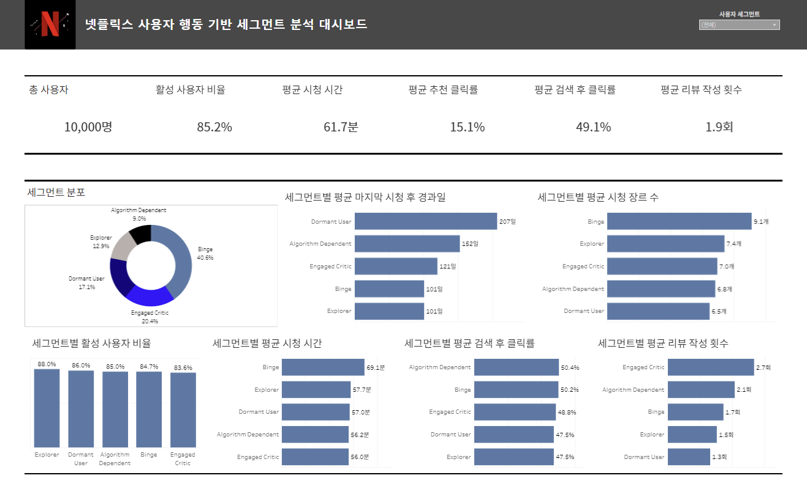
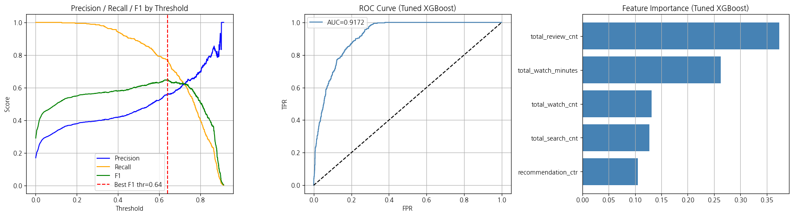

# Netflix 사용자 행동 세그먼트 분석 및 휴면 사용자 분류

시청·검색·추천·리뷰 로그를 사용자 단위로 통합하고, 행동 특성에 따라 고객을 구분해 세그먼트별 리텐션 전략을 제안한 BDAI 13팀 프로젝트입니다.

**MySQL · Python · Tableau · XGBoost**

> 실제 Netflix 고객 데이터가 아닌 시뮬레이션 데이터 분석입니다. 모델은 분석에서 정의한 `Dormant User` 세그먼트를 분류합니다. 실제 구독 해지나 미래 이탈을 검증한 모델로 해석하지 않습니다.

## 한눈에 보기

| 항목 | 내용 |
| --- | --- |
| 분석 데이터 | 원본 6개 CSV, 중복 포함 210,290행 |
| 사용자 데이터마트 | 10,000명 · 28개 컬럼 |
| 세그먼트 | Binge / Explorer / Algorithm Dependent / Engaged Critic / Dormant User |
| 모델 비교 | Logistic Regression, Decision Tree, Random Forest, GBM, XGBoost, LightGBM |
| 교차검증 | 튜닝된 XGBoost의 5-Fold CV Best ROC-AUC 0.9064 |
| 저장된 최종 평가 출력 | AUC 0.9172 · Recall 0.7719 · Precision 0.5641 · F1 0.6519 |
| 본인 역할 | Tableau 대시보드 제작, 최종 발표 / SQL 분석·모델링은 팀 공동 수행 |

수치는 제공 노트북에 저장된 과거 실행 결과입니다. 0.9172는 임계값 선택에도 사용한 평가 세트 점수이며 완전히 독립된 최종 테스트 결과가 아닙니다. [평가 조건과 한계](reports/technical_report.md#평가-해석과-한계)를 함께 확인하세요.

## Project Workflow

**데이터 이해 → SQL 전처리 → 사용자 데이터마트 → 행동 세그먼트 분석**

세그먼트 결과를 바탕으로 **Tableau 대시보드 시각화**와 **휴면 사용자 분류 모델 비교·튜닝**을 수행하고, 결과를 종합해 **세그먼트별 리텐션 전략**을 제안했습니다.

## Tableau 대시보드



사용자 세그먼트를 선택해 시청 시간, 최근 시청 후 경과일, 장르 수, 검색 클릭률, 리뷰 참여와 활성 사용자 비율을 비교합니다. **정채환이 대시보드 제작과 최종 발표를 담당했습니다.**

[Tableau 편집 파일과 연결 안내](tableau/README.md)

## 분석 결과

- 사용자 행동을 소비 강도·탐색 방식·참여·최근성의 네 축으로 점수화하고, 규칙에 따라 다섯 세그먼트로 구분했습니다. 비지도 군집화 모델을 학습한 방식은 아닙니다.
- 세그먼트별 소비·참여 차이를 대시보드로 비교하고, 추천 의존형 사용자의 추천 경험 개선, 몰입형 사용자의 콘텐츠 확장, 휴면 사용자의 재참여 유도 전략을 제안했습니다.
- 최종 노트북은 상위 5개 행동 변수를 사용해 XGBoost를 튜닝했습니다. 임계값 0.6416에서 휴면 라벨 342명 중 264명을 분류했으며 미탐지는 78명이었습니다.
- 전략은 분석에 근거한 제안입니다. 캠페인 실행이나 실제 이탈률 감소 효과를 측정하지 않았습니다.



## 본인 기여

| 구분 | 정채환의 기여 |
| --- | --- |
| 개인 담당 | Tableau 대시보드 제작, 최종 발표 |
| 공동 수행 | SQL 기반 데이터 이해·전처리·행동 지표 및 세그먼트 분석, 모델링 |

팀원: 이창현(팀장), 조용은, 임예원, 정채환. 본인 기여 구분은 작성자의 확인을 반영했습니다. 공동 작업을 개인 단독 성과로 표기하지 않았습니다.

## 코드와 기술보고서

| 자료 | 바로가기 |
| --- | --- |
| SQL 분석 코드 | [sql/](sql/) |
| 최종 휴면 사용자 모델링 | [노트북](notebooks/01_dormant_user_modeling.ipynb) |
| 초기 활성 상태 로지스틱 회귀 분석 | [별도 타겟의 탐색 노트북](notebooks/02_active_status_logistic_baseline.ipynb) |
| 기술보고서 | [분석 방법·평가 결과·한계](reports/technical_report.md) |
| 원본 분석 설명 자료 | [reports/reference/](reports/reference/) |
| 데이터 관계도 | [ERD](assets/erd.png) |

## 저장소 구성

```text
sql/            MySQL 분석 쿼리 9개와 실행 안내
notebooks/      최종 모델링 및 초기 로지스틱 회귀 분석
reports/        기술보고서와 기존 분석 설명 자료
tableau/        편집 가능한 대시보드 정의와 재연결 안내
assets/         대시보드, ERD, 저장된 모델 결과 이미지
data/           데이터 출처·스키마 안내 (실제 레코드 제외)
docs/           원본 파일 대응표와 정리 범위
requirements.txt
```

## 실행 안내

1. [데이터 안내](data/README.md)를 확인하고 이용 조건에 맞게 원본 CSV를 준비합니다. 데이터 파일은 이 저장소에 포함하지 않았습니다.
2. MySQL 8.0 환경에서 [SQL 실행 안내](sql/README.md)에 따라 필요한 구간을 실행하고 데이터마트를 CSV로 내보냅니다. SQL은 탐색용 쿼리 모음이며 한 번에 실행하는 자동 파이프라인이 아닙니다.
3. CSV를 `data/processed/user_behavior_segment.csv`에 놓습니다.
4. 아래 명령을 저장소 루트에서 실행한 뒤, `notebooks/` 폴더의 노트북을 위에서부터 실행합니다.

```bash
python -m pip install -r requirements.txt
python -m jupyterlab
```

원본 환경의 패키지 버전이 없어 의존성 버전은 고정하지 않았습니다. 이번 정리는 파일·구문·링크를 확인한 것이며 MySQL 전체 실행, 모델 재학습, Tableau 재연결은 수행하지 않았습니다.

## 출처와 공개 범위

원본 발표자료의 데이터 출처는 **Kaggle Netflix 2025 User Behavior Dataset**입니다. 원본 URL과 재배포 조건을 확정할 자료가 없어 원본·가공 CSV와 Tableau 내장 추출 데이터는 제외했습니다. 코드·그림·분석 설명 자료는 BDAI 13팀 프로젝트 자료이며, 팀 결과물 전체에 임의의 오픈소스 라이선스를 부여하지 않았습니다.

[원본 파일 대응 및 변경 내역](docs/source_map.md)

원본 발표 PPT·PDF는 가독성을 고려해 공개 파일에서 제외하고, 필요한 이미지와 내용을 기술보고서에 재구성했습니다.
