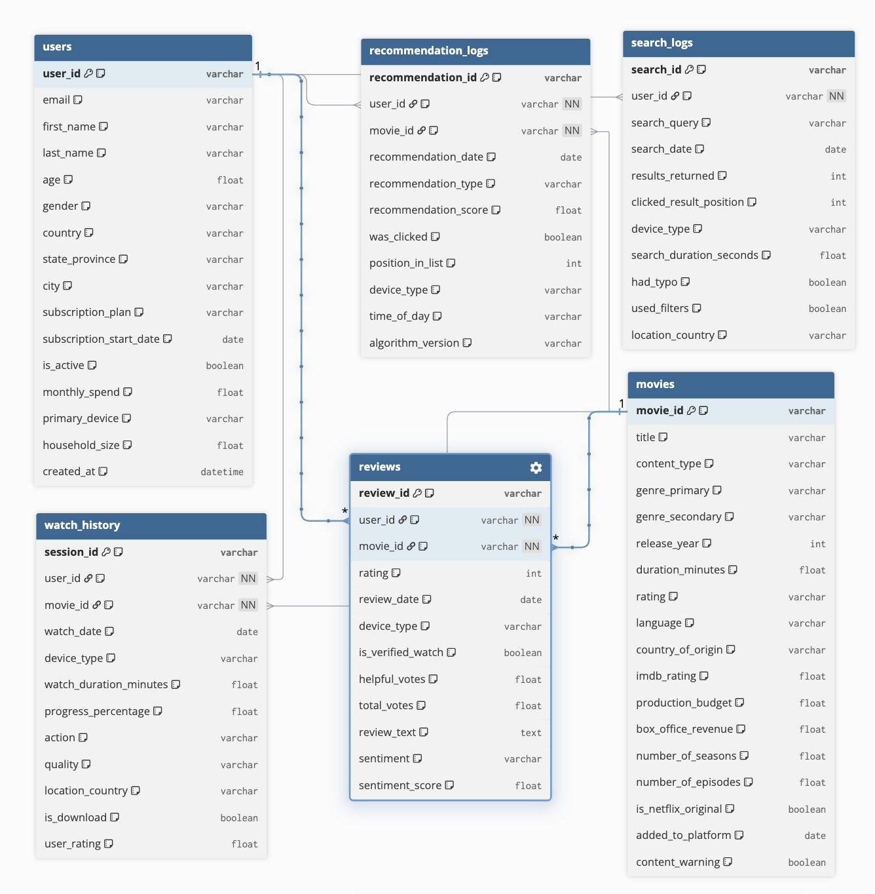
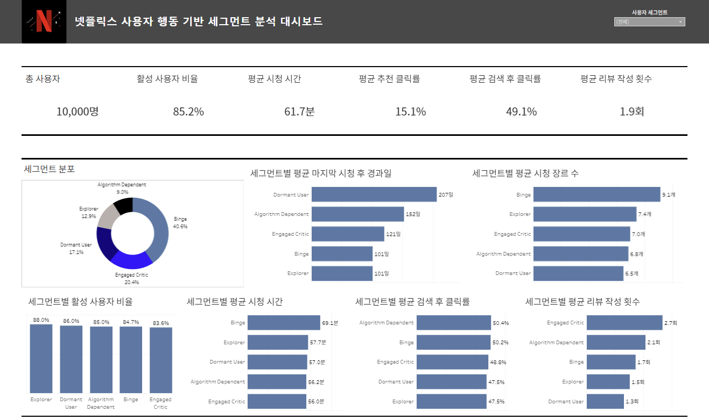
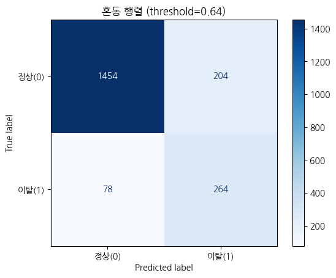

# Netflix 사용자 행동 분석 기술보고서

시청·검색·추천·리뷰 로그를 사용자 단위로 통합하고, 행동 세그먼트 분석과 휴면 사용자 분류를 통해 리텐션 전략을 검토했다.

## 1. 문제와 목표

스트리밍 사용자의 행동을 사용자 단위로 통합해 소비 패턴을 구분하고, 세그먼트별 참여 회복·유지 전략을 제안했다. 분석에서 정의한 휴면 사용자 세그먼트를 행동·속성 변수로 분류하는 모델도 비교했다.

분류 대상은 행동 지표로 정의한 휴면 사용자이다. 실제 해지 이력이나 미래 관측 구간을 사용하지 않아 결과의 해석 범위를 현재 세그먼트 분류로 한정했다.

## 2. 데이터

Kaggle Netflix 2025 User Behavior Dataset은 스트리밍 서비스의 사용자 행동을 모사한 시뮬레이션 데이터이다. 분석에 사용한 CSV는 users, movies, watch_history, recommendation_logs, search_logs, reviews의 6개 파일이다. 중복 포함 원본은 합계 210,290행이며 사용자 데이터마트는 10,000행, 28열이다.

각 로그를 먼저 사용자 단위로 집계한 뒤 결합해 시청·추천·검색·리뷰 지표를 구성했다. 파일별 원본 행 수는 [데이터 안내](../data/README.md)에 기록했다.

## 3. SQL 전처리와 행동 지표

- 완전히 동일한 중복 행 제거와 데이터 형식 정리
- 연령대 범주화 및 불가능한 연령을 Unknown으로 구분
- 월 지출·시청 시간·검색 시간의 결측치 대체 및 극단값 상한 처리
- 의미상 자연스러운 결측치는 유지하고, 필요한 컬럼에는 중앙값·평균·최빈값 등 적용
- 시청 횟수·총 시청 시간·시청 완료율·최근 시청일·장르 수·추천 클릭률·검색 클릭률·리뷰 횟수 등을 사용자 단위로 통합

결측치와 이상치는 컬럼의 의미와 분포에 따라 처리했다. 월 지출 등에는 분위수 상한을 적용하고, 콘텐츠 길이는 300분을 상한으로 사용했다. [전처리 근거](reference/preprocessing_rationale.pdf)에 컬럼별 기준을 정리했다.

## 4. 행동 세그먼트

SQL Version 2는 시청 시간, 추천 클릭률, 검색 횟수, 리뷰 횟수, 최근 시청일의 분위수를 사용해 소비 강도·탐색 방식·참여·최근성 점수를 만들고 CASE 순서로 세그먼트를 지정한다. 점수가 동률이면 먼저 적힌 조건이 우선한다.

| 세그먼트 | 사용자 수 |
| --- | ---: |
| Binge | 4,058 |
| Explorer | 1,285 |
| Algorithm Dependent | 903 |
| Engaged Critic | 2,042 |
| Dormant User | 1,712 |

분위수 점수와 조건식으로 10,000명의 사용자를 다섯 세그먼트에 배정했다.

## 5. 대시보드와 전략

연구 기획부터 데이터 전처리, 행동 지표 설계, 세그먼트 분석, 모델링, Tableau 시각화까지 전 과정을 팀원들과 함께 진행했다. 최종 발표는 정채환이 담당했다.

대시보드에서 세그먼트별 시청·탐색·리뷰 특성과 활성 상태를 비교한다. 추천 의존형에는 추천 경험 개선, 몰입형에는 콘텐츠 탐색 확장, 휴면 사용자에는 재참여 유도 방안을 제안했다. 전략 제안까지 진행했으며, 캠페인 실행과 이탈률 감소 효과는 검증하지 않았다.

## 6. 모델링 절차

최종 노트북의 타겟은 `segment == 'Dormant User'`이면 1, 나머지는 0이다. 초기 로지스틱 회귀 노트북의 `is_active` 타겟과는 별개의 분석이다.

1. 사용자 속성 및 행동 변수 15개를 선택하고 범주형 변수를 더미 인코딩했다. 로지스틱 회귀에 StandardScaler를 적용했다.
2. 초기 비교는 층화 70:30 분할로 6개 분류기를 비교했다.
3. XGBoost 변수 중요도를 바탕으로 `total_review_cnt`, `total_watch_minutes`, `recommendation_ctr`, `total_search_cnt`, `total_watch_cnt`의 5개 변수를 선택했다.
4. 상위 변수 단계에서 층화 80:20으로 다시 분할했다. `X = df[top_features]`를 사용해 원본 가공 CSV의 결측을 남긴 상태이며 초기 15개 변수 단계와 전처리가 동일하지 않습니다.
5. RandomizedSearchCV로 50개 후보와 5-Fold ROC-AUC 평가를 사용했다.
6. 평가 세트에서 Recall 0.75 이상을 만족하는 임계값 중 Precision이 가장 큰 값을 선택했다.

## 7. 모델 평가 결과

| 지표 | 값 | 해석 범위 |
| --- | ---: | --- |
| CV Best ROC-AUC | 0.9064 | 튜닝 시 훈련 분할 내 5-Fold 점수 |
| Train ROC-AUC | 0.9225 | 튜닝 모델 훈련 분할 |
| 평가 세트 ROC-AUC | 0.9172 | 80:20 분할의 20%, 임계값 선택에도 사용 |
| 임계값 | 0.6416 | 평가 세트에서 선택 |
| Accuracy | 0.8590 | 동일 평가 세트 |
| Precision | 0.5641 | 동일 평가 세트 |
| Recall | 0.7719 | 동일 평가 세트 |
| F1 | 0.6519 | 동일 평가 세트 |
| KS | 0.6835 | 두 라벨의 예측 확률 분포 비교 |
| PSI | 0.0084 | 훈련·평가 무작위 분할 간 분포 비교 |

혼동행렬은 TN 1,454, FP 204, FN 78, TP 264이다. 기본 임계값 0.5에서 Recall 0.8830, Precision 0.4632였고, 0.6416으로 올리면 Recall은 낮아지고 Precision이 높아졌습니다. Recall 0.75 이상을 유지하면서 정밀도를 높이는 방향으로 임계값을 조정했다.

원본 출력의 최적 파라미터는 `n_estimators=200`, `max_depth=5`, `learning_rate=0.03`, `subsample=0.8`, `colsample_bytree=0.7`, `min_child_weight=1`, `reg_alpha=0.1`, `reg_lambda=1.0`, `gamma=0.5`이다. 발표 슬라이드의 learning_rate 0.3 표기는 코드·저장된 결과의 0.03과 다릅니다.

## 평가 해석과 한계

- **라벨과 입력의 구조적 중첩:** 휴면 라벨 자체가 시청·검색·리뷰·추천·최근성 점수에 따른 규칙으로 만들어집니다. 이와 겹치는 입력으로 같은 시점의 세그먼트를 분류하므로 점수는 정의한 분류 규칙을 재현하는 능력도 반영한다. 미래 해지 예측 성능을 증명하지 않습니다.
- **독립 평가 부족:** 평가 세트로 임계값을 선택하고 같은 세트의 성능을 보고했다. 초기 70:30 분할에서 정한 변수로 전체 데이터를 80:20 재분할해 평가 사용자 일부가 변수 선택 과정에도 관여할 수 있다. 새 최종 홀드아웃과 훈련 내부 변수 선택이 필요한다.
- **시점 분리 부재:** 행동을 집계한 관측 기간과 이후 결과 기간을 분리하지 않았다. 실제 운영용 예측에는 관측일 기준 피처 생성과 미래 결과 라벨 정의가 필요한다.
- **분포 안정성 범위:** PSI는 무작위 훈련·평가 분할 비교이다. 시간 경과에 따른 운영 안정성 검증이 아니다.
- **통계 해석 범위:** 중요도·IV·집단별 평균 차이만으로 휴면 원인이나 리텐션 전략의 효과를 단정할 수 없다.
- **재현 환경:** 패키지 버전 고정 정보와 데이터 재배포 조건이 없어 완전한 독립 재현 환경은 아니다.

## 8. 후속 개선 방향

관측 시점과 미래 휴면·해지 기간을 분리해 라벨을 만들고, 훈련 데이터 안에서 변수 선택·튜닝·임계값 결정을 마친 뒤 독립 홀드아웃에서 평가할 수 있다. 대시보드는 이 결과와 연계해 세그먼트별 대상 규모와 운영 결과를 추적하는 방향으로 확장할 수 있다. 

## 9. 원본 자료

- 대시보드·모델 평가 이미지는 최종 발표자료와 분석 노트북에서 추출
- [원본 모델링 설명](reference/modeling_notes.pdf)
- [전처리 근거](reference/preprocessing_rationale.pdf)
- [원본 파일 대응표](../docs/source_map.md)
