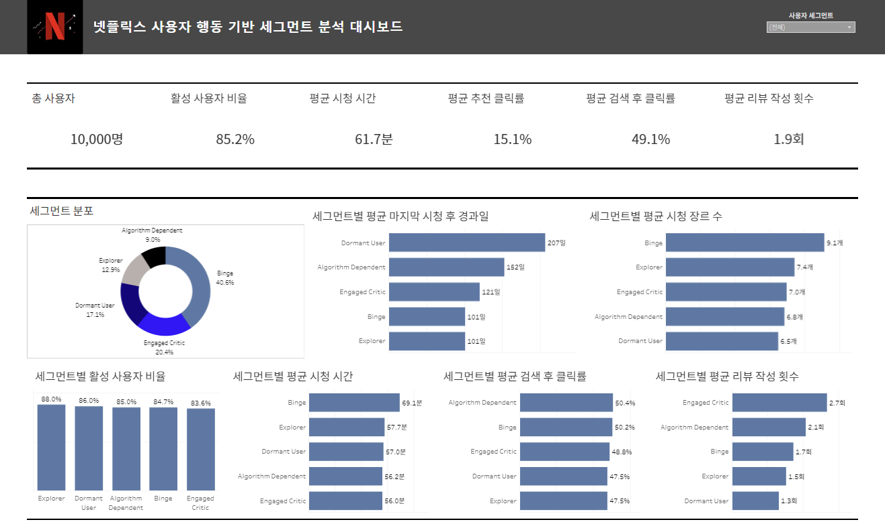

# Tableau 대시보드

정채환이 제작한 대시보드입니다. 원본 `.twbx`에서 편집 가능한 `.twb`를 추출하고 개인 로컬 경로를 상대 경로로 바꿨습니다. 데이터가 내장된 `.hyper` 추출본과 임시 복구 파일은 포함하지 않았습니다.

Tableau Desktop에서 `netflix_segments.twb`를 열고, 데이터 원본 연결 편집으로 `data/processed/user_behavior_segment.csv`를 지정하세요. 원본 추출 연결이 없다는 안내가 나오면 CSV 원본으로 연결을 교체하거나 추출을 새로 만드세요. 이 정리본은 Tableau Desktop에서 다시 열어 검증하지 않았습니다.

대시보드의 최근 시청 후 경과일은 기준 날짜에 따라 달라질 수 있습니다. 화면 수치는 발표 당시 값입니다.
